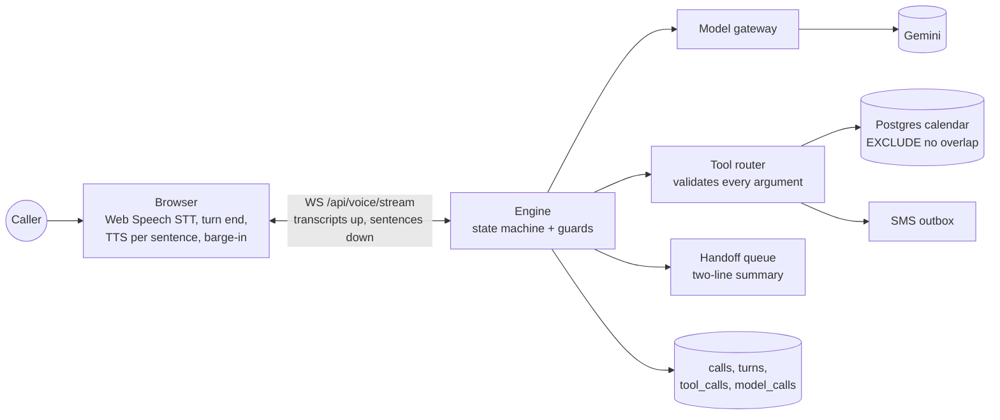

# AI Phone Receptionist

A voice agent for a salon front desk: callers book, reschedule or cancel; the agent checks a live calendar, reads
every booking back before committing it, sends a confirmation text, and hands off to a human the moment the caller
asks or the agent gets stuck. Build 03 of the AI Engineer Projects Roadmap: **real-time voice, tool calling, session
state, human handoff**.

**Live link:** not deployed yet (see [DEPLOYMENT.md](DEPLOYMENT.md)). **Demo video:** not recorded yet.

> Built a phone booking agent on a live calendar: **0 double bookings across 104 simulated calls** (plus 34 in
> the final live run), **handoff when required 6/6 with 0/27 false handoffs**, and **33/33 labelled scenarios passed** in one live run
> with Gemini 3.5 Flash-Lite (prompt v3). Server turn latency p50 1.37 s / p95 5.7 s (model included; browser
> speech excluded).

## Results

33 hand-labelled caller scenarios (simple booking, no free slot, reschedule, cancel, caller changes their mind,
noisy line, angry caller, wants a human, unknown request, a two-caller race). Every check reads the **database end
state and the tool log**, not the agent's words. Details: [evaluation/README.md](evaluation/README.md).

| Run (published folder) | Brain | Prompt | Passed | Handoff when required / when not | Router rejected | Double bookings | Server turn p50 / p95 |
|---|---|---|---|---|---|---|---|
| `offline-rules-scripted` | rule-based reference policy | (n/a) | 33/33 | 6/6 · 0/27 | 0/95 | 0 (104 calls incl. burst + load) | 26 / 61 ms |
| `live-v1-…-sample` | Gemini 3.5 Flash-Lite | v1 | 5/6 (+1 hit the per-minute rate limit) | 2/2 · 1/4 | 2/16 | 0 | 1306 / 4170 ms |
| `live-v2-…-scripted` | Gemini 3.5 Flash-Lite | v2 | 31/33 | 6/6 · 0/27 | 0/98 | 0 | 1656 / 6403 ms |
| `live-v3-…-scripted` | Gemini 3.5 Flash-Lite | v3 | **33/33** | 6/6 · 0/27 | 3/99 | 0 | **1367 / 5716 ms** |
| `live-v3-handoff-recheck` | Gemini 3.5 Flash-Lite | v3 | 6/6 (handoff scenarios, after the spoken-handoff fix) | 6/6 · n/a | 0/4 | 0 | 750 / 2983 ms |

How to read this:

- The **rules** row is a deterministic reference policy, not a model, and its parser was fixed against these same
  scenarios (its first run scored 29/33). It shows the system around the model (state machine, tools, constraint,
  handoff rules) holds, and it is free, so CI runs it nightly. It says nothing about language understanding.
- The **Gemini** rows are single live runs on a free-tier key with scripted callers, so they vary from run to run.
  v1→v2→v3 are prompt and guard fixes made because of specific live failures (below).
- Latency is **server time from caller text to the first agent sentence**. It includes the model and excludes
  in-browser speech recognition and synthesis; real browser calls also record end-of-speech → first audio
  (`turns.eos_to_audio_ms`, shown on the Call log page). No browser-voice latency numbers are published because no
  measured set of real voice calls exists yet.
- Cost per call: not reported. The key is on the free tier, so `model_calls.cost_usd` is left null rather than
  invented; set `MODEL_PRICE_*` to fill it.

Concurrency (rules brain; this tests the database, not the model): 10 callers saying yes to one slot at the same
instant → 1 booked, 9 told it was just taken; 60 complete booking calls on 8 threads → 56 bookings, 44 "just taken"
refusals handled, 0 overlaps (the count varies slightly between runs because thread timing does).

### What the evaluation changed

| Found by | Problem | Fix |
|---|---|---|
| Load phase (60 calls, 8 threads) | Concurrent overlapping inserts **deadlocked** inside the exclusion check | Per-staff `pg_advisory_xact_lock` before booking writes; residual `40P01` treated as "slot taken" |
| Live v1, s18 | After "no, Thursday instead" the model booked the stale slot id shown in the prompt; the router refused, call handed off | A new search voids the pending read-back; the prompt shows aliases only (prompt v2) |
| Live v2, s23 | Caller ID withheld: the model **invented a phone number** | `book` accepts only the caller ID or digits the caller actually said (prompt v3) |
| Live v2, s31 | The model read the booking back itself, so the tool read it back again | Prompt v3: never read back yourself; the tool does it |
| Driving the UI | Guard-triggered handoffs (e.g. "can I talk to a person") changed state but **spoke nothing** | The transfer line is now spoken; the evaluation also checks that a handoff is said out loud |
| Offline v1 | Rule-policy parsing bugs (names, "10:30") | Fixed (29/33 → 33/33) |

In every live model failure above, the safeguards held: nothing was booked that the caller had not confirmed.

## Architecture



| Layer | Choice in this build |
|---|---|
| Telephony | None: the browser is the phone (a real number was out of scope; see DEPLOYMENT.md) |
| Speech | Browser Web Speech API (recognition + synthesis); the agent server never sees audio |
| Model | Gemini, streamed, through one gateway that logs every attempt. Evaluated on `gemini-3.5-flash-lite`; the deployment default is `gemini-3-flash-preview` so it has its own free-tier quota (live-tested at 1.2 to 1.7 s per turn, but not run through the scenario evaluation) |
| Agent | A plain loop: code-owned state machine, one tool per turn, tool results spoken directly |
| Calendar | Built-in: staff shifts + a `bookings` table with a Postgres exclusion constraint |
| Backend | FastAPI, SQLAlchemy 2, Alembic, PostgreSQL 16 |
| Frontend | React 19, Vite, TypeScript, Tailwind v4, TanStack Query, React Router |

The full walkthrough with file paths and diagrams is in [WORKFLOW.md](WORKFLOW.md). Prepared answers are in
[INTERVIEW_QUESTIONS.md](INTERVIEW_QUESTIONS.md).

## The one rule: the calendar is the truth

The model never decides a slot is free. It calls `find_slots`, gets aliases (`slot_1`, `slot_2`) for real free
times, and can only `book` one of those. `book` first reads the details back ("a haircut tomorrow, Tuesday the 3rd
at 10 AM with Asha, for Shlok, that's S, H, L, O, K…"); only the identical call after a clear yes commits, and the
database itself refuses an overlapping booking:

```sql
EXCLUDE USING gist (staff_id WITH =, tstzrange(starts_at, ends_at, '[)') WITH &&) WHERE (status <> 'cancelled')
```

## Run it locally (three commands, plus installs)

Prerequisites: Docker, Python 3.12+ (developed on 3.14), Node 22+.

```bash
docker compose up -d db
```

```bash
cd backend && python -m venv .venv && .venv/Scripts/pip install -r requirements-dev.txt && cp .env.example .env && .venv/Scripts/python -m alembic upgrade head && .venv/Scripts/python -m scripts.seed --demo && .venv/Scripts/python -m uvicorn app.main:app --port 8010
```

```bash
cd frontend && npm install && npm run dev
```

(On macOS/Linux use `.venv/bin/` instead of `.venv/Scripts/`.) Put your `GEMINI_API_KEY` in `backend/.env`, or set
`AGENT_BRAIN=rules` to run without a key. Open http://localhost:5174, press **Start call**, and talk (Chrome or Edge)
or type.

## Tests

```bash
cd backend && .venv/Scripts/python -m pytest
```

```bash
cd frontend && npm test
```

```bash
backend/.venv/Scripts/python evaluation/run_eval.py --brain rules
```

Backend tests need the compose database (they use `reception_test`; tests that need Postgres skip if it is not
running). They never call Gemini: `GEMINI_API_KEY` is blanked and the model is a `ScriptedProvider` or the rule
brain. Last run: backend 91 passed, frontend 7 passed, offline evaluation 33/33.

## Milestones (roadmap)

| | Milestone | Status |
|---|---|---|
| M1 | Text-only agent with tools: a chat UI books, moves and cancels | Done (text mode on the Call page; API tests) |
| M2 | Bookings table + calendar sync: two parallel bookings for one slot, one fails | Done (8-thread test, 10-caller burst); "sync" is the built-in calendar |
| M3 | Voice in the browser, barge-in works | Built (Web Speech STT/TTS, barge-in, echo filter); stream and barge-in path tested over the socket, not with a real microphone in CI |
| M4 | A real phone number: a call books a slot and the SMS arrives | **Not built** (no paid telephony by choice); SMS goes to a simulated outbox |
| M5 | Saying "human" transfers the call with a summary | Done for the browser call: handoff queue with a two-line summary; no telephony transfer |
| M6 | Scripted calls run nightly with pass or fail | Done: `run_eval.py --strict` in `.github/workflows/ci.yml` on a nightly schedule (the workflow has not run, as the repo is not pushed) |

## Decisions and trade-offs

- **Browser speech, not Gemini Live or Twilio.** Free, testable, and the free-tier key's Live quotas were unknown.
  Costs: no phone number, browser-dependent recognition quality, and end-of-turn detection is whatever Chrome does.
- **One model call per turn.** Tool results are spoken directly instead of being sent back to the model. Halves
  model calls on tool turns; the wording of results is templated.
- **Deterministic guards next to the model.** "Talk to a person" hands off without asking the model; a clear-yes
  check gates every commit; phone numbers must have been said. They are cheap, testable and do not drift.
- **A rule-based brain with the same interface.** Lets the whole pipeline be evaluated for free in CI; clearly
  labelled as not a language model.
- **Next with more time:** a deployed demo and recorded video, an LLM-caller run over all scenarios, repeated live
  runs to report variance, Gemini Live as a second voice path, and Twilio for M4.

## Repository map

```
backend/app/agent/      engine.py (turns), state.py (states, guards), tools.py (router), rules.py, gemini_brain.py
backend/app/llm/        gateway.py (one door), providers.py (SDK), prompts.py (versioned)
backend/app/services/   calendar.py (free/busy, constraint handling), notify.py (SMS outbox), speech.py, phone.py
backend/app/api/        routes.py (REST), voice.py (WebSocket)
backend/migrations/     0001 schema + exclusion constraint
evaluation/             scenarios, run_eval.py, published results
frontend/src/           lib/useCall.ts (browser call), pages/ (Call, Calendar, Call log, Handoffs, Texts)
```
