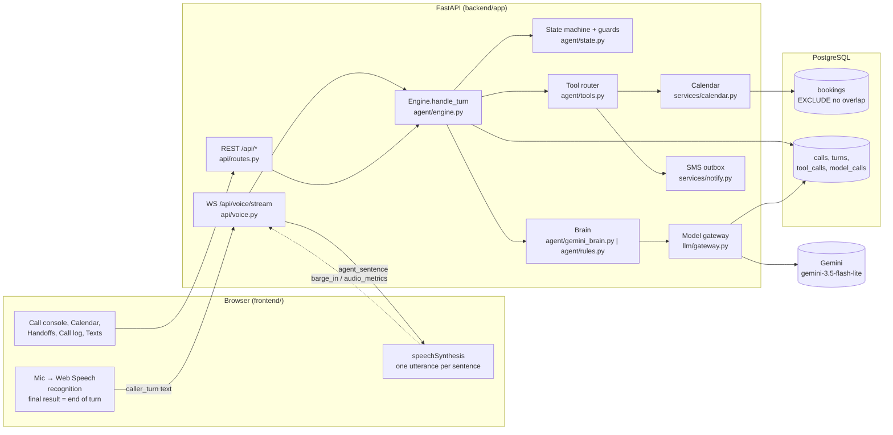
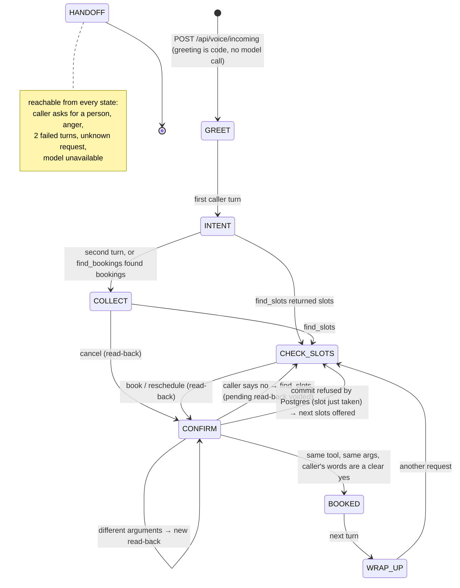
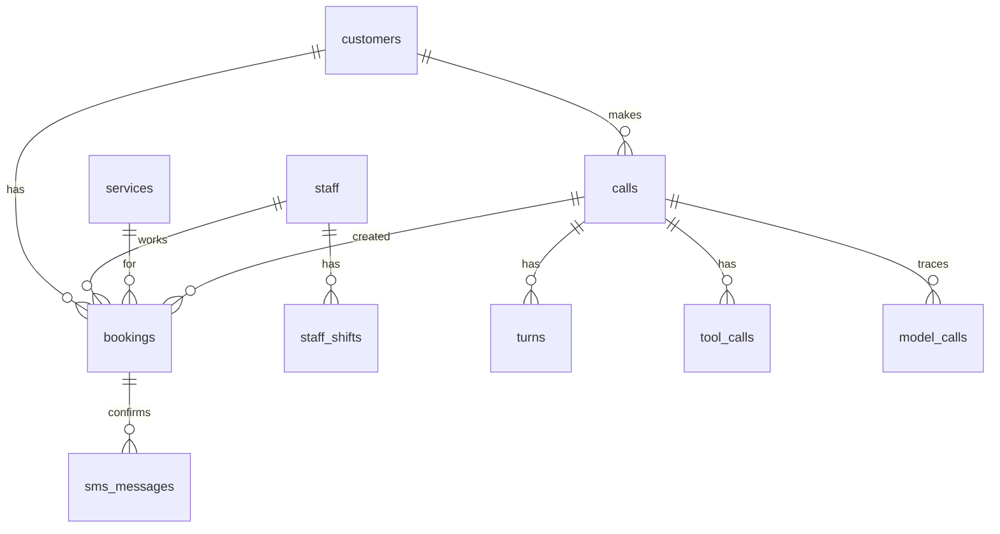
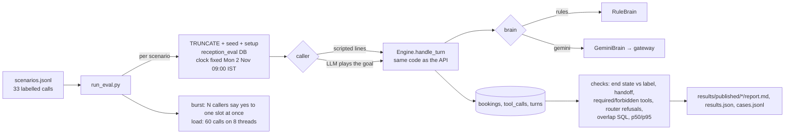

# How it works

This is the implementation as it exists in the code, with file paths. The roadmap's Build 03 diagram has a
telephony provider in front; in this build the **browser plays the phone**: it does speech-to-text, turn detection,
text-to-speech and barge-in, and talks to the same agent server over a WebSocket.

## Architecture



Layer choices (roadmap page 2, "pick one option per layer"): React + Vite frontend, FastAPI, PostgreSQL for
everything, Gemini behind one gateway, a plain loop instead of an agent framework, the browser's Web Speech API for
speech, and the built-in Postgres calendar instead of Google Calendar.

## One turn, end to end

```mermaid
sequenceDiagram
  autonumber
  participant B as Browser
  participant W as WS /api/voice/stream
  participant E as Engine
  participant M as Gemini (gateway)
  participant T as Tool router
  participant D as Postgres
  B->>B: recogniser final result (eos = performance.now())
  B->>W: {"type":"caller_turn","text":"haircut tomorrow morning"}
  W->>E: handle_turn (worker thread)
  E->>D: SELECT call FOR UPDATE, insert caller turn
  E->>E: state transition; guards (asks for human? angry?)
  E->>M: stream(system prompt with state + allowed tools + facts, history)
  M-->>E: function_call find_slots(service, date_from, date_to)
  E->>T: run_tool: state allows it? schema valid?
  T->>D: free/busy from shifts minus bookings
  T-->>E: speakable result + state CHECK_SLOTS + offered slot_1..slot_n
  E-->>W: agent_sentence × 2 (sentence by sentence)
  W-->>B: speak first sentence → audio starts
  E->>D: tool_calls row, agent turn (server_first_ms, server_total_ms)
  W-->>B: turn_done {seq, state, outcome, tools}
  B->>W: audio_metrics {seq, eos_to_audio_ms}
```

Key code: `Engine.handle_turn` in `backend/app/agent/engine.py`, the socket loop in `backend/app/api/voice.py`, and
the browser side in `frontend/src/lib/useCall.ts`.

**One model call per turn.** Every tool returns a short, speakable sentence (`ToolResult.say`). The engine speaks
it directly instead of sending the tool result back to the model for a second round trip, so a turn costs one model
call whether or not a tool ran. The model sees what happened on the next turn through the call's history and the
"what this call knows" facts block (`render_facts` in `backend/app/llm/prompts.py`).

## The state machine



`ALLOWED_TOOLS` in `backend/app/agent/state.py` lists each state's tools. The gateway only declares those tools to
the model (`tool_schemas(db, allowed)`), and the router refuses anything else with `tool_not_allowed`, so the rule
holds even if the model emits a tool it was not offered. `transfer_to_human` is allowed everywhere.

### Two-phase commit for book, reschedule, cancel

`_two_phase` in `backend/app/agent/tools.py`:

1. First call (from any state that allows it): validate everything (slot still free, phone valid, booking found),
   store `session.pending = {tool, args}`, move to CONFIRM, and speak a read-back such as "Just to confirm: a haircut
   tomorrow, Tuesday the 3rd at 10 AM with Asha, for Shlok, that's S, H, L, O, K, and I'll text the number ending
   3 2 1 0. Shall I book it?"
2. Second call commits only if the state is CONFIRM, the arguments equal the pending ones, **and**
   `is_clear_yes(caller_text)` is true (deterministic: "yes but at 11" is not a yes). Otherwise it refuses with
   `not_confirmed` and repeats the read-back.

### Guard rails that do not depend on the model

| Rule | Where | What it does |
|---|---|---|
| Explicit request for a person | `asks_for_human` in `agent/state.py`, called in `Engine.handle_turn` | Hands off before the model is even called (reason `caller_request`) |
| Anger | `sounds_angry` | Hands off (reason `angry_caller`) |
| Two failed turns | `Engine._brain_turn`, `MAX_FAILED_TURNS` | Consecutive turns where the model failed, returned nothing, or a tool call failed validation → `repeated_failure` |
| Model unavailable | `GeminiBrain` marks quota/auth/config/daily-limit/rate-limit errors fatal | Immediate handoff (`model_unavailable`) instead of silence |
| Only offered slots | `_slot_from_alias` | `book` only accepts `slot_1…` aliases (or their ids) from this call's latest `find_slots` |
| Only heard phone numbers | `_heard_phone` | A phone must be the caller ID or digits the caller actually said (`phone_not_heard`) |
| Clear yes | `is_clear_yes` | Required for every commit |

The handoff summary is built from session state, not by the model (`summarize` in `agent/engine.py`), for example:

```
Wants to book a haircut; Zara, +919876543210.
Transferred: caller request. Last said: "Actually just put me through to the manager."
```

## Tools

Defined in `backend/app/agent/tools.py` (argument models, JSON schemas, handlers, router).

| Tool | Arguments | Notes |
|---|---|---|
| `find_slots` | `service` (enum from DB), `date_from`, `date_to` (local `YYYY-MM-DD` or `YYYY-MM-DDTHH:MM`), optional `staff` (enum) | Returns up to 6 options at least an hour apart; speaks the first two; voids any pending read-back |
| `find_bookings` | `phone_e164` | Upcoming confirmed bookings as `booking_1…`; an addition to the roadmap's list, needed before reschedule/cancel |
| `book` | `slot_id`, `name`, `phone_e164` | Two-phase; idempotency key `call_id:slot_id` |
| `reschedule` | `booking_id`, `new_slot_id` | Two-phase; the moved booking is excluded from its own conflict check |
| `cancel` | `booking_id`, `reason` | Two-phase |
| `transfer_to_human` | `reason` (enum), `summary` (≤300 chars) | Sets `calls.handoff_status = waiting`; the Handoffs page is the receptionist's queue |

`run_tool` logs one `tool_calls` row per attempt (accepted or refused) with args, state, latency, error code and
who called it (`model`, `guard` or `api`).

## The calendar is the truth

`backend/app/services/calendar.py` and `backend/migrations/versions/0001_initial_schema.py`.

- Free/busy: staff shifts (`staff_shifts`, local time) on a 15-minute grid, minus live bookings, minus anything
  inside `MIN_NOTICE_MINUTES` or beyond `BOOKING_HORIZON_DAYS`.
- A slot id is `"{staff_id}.{service}.{YYYYMMDDTHHMMZ}"`. `validate_slot` re-derives it from scratch on every use.
- The guarantee is the database:

```sql
CREATE EXTENSION IF NOT EXISTS btree_gist;
ALTER TABLE bookings ADD CONSTRAINT bookings_no_overlap
  EXCLUDE USING gist (staff_id WITH =, tstzrange(starts_at, ends_at, '[)') WITH &&)
  WHERE (status <> 'cancelled');
```

- Writes run inside a SAVEPOINT; an exclusion violation (`23P01`) becomes `SlotTaken`, the agent apologises and
  offers the next free times, and the caller's transaction (turn rows, tool log) still commits.
- Before writing, `lock_staff_calendar` takes `pg_advisory_xact_lock` per staff member. The evaluation's load phase
  found that two transactions inserting *overlapping* rows at the same moment deadlock inside the exclusion check
  (each waits on the other's uncommitted row; Postgres kills one with `40P01` after `deadlock_timeout`). With the
  lock, the second writer waits, then sees the committed row and gets a clean violation. A residual `40P01` is
  still mapped to `SlotTaken`.
- UTC is stored; local time is spoken (`backend/app/services/speech.py`: "tomorrow, Tuesday the 3rd at 10 AM").

`CalendarSync` is the seam for Google Calendar or Cal.com; the default `LocalCalendar` only sets
`event_id = "local:<booking id>"` because the bookings table is the calendar.

## The model gateway

`backend/app/llm/gateway.py` and `backend/app/llm/providers.py`. Only `providers.py` imports the Gemini SDK.

- Streams the reply. Text deltas go straight to the engine's `SentenceStream`, which emits each finished sentence
  to the socket so speech starts before the model is done.
- Keeps the first function call only (one tool per turn).
- Retries `server_error`/`timeout`/`network_error` once, **only if no text has been spoken yet** (otherwise the
  caller would hear words twice). The SDK's own retries are disabled so every attempt is logged.
- Refuses to call when `DAILY_MODEL_CALL_LIMIT` is reached in the last 24 h.
- Writes one `model_calls` row per attempt in its own transaction (`services/observability.py`): trace id, call id,
  `build03`, feature, model, prompt version, tokens, `latency_ms`, `first_token_ms`, status, error category.
  `cost_usd` stays null unless `MODEL_PRICE_*` is set, because the free tier has no price to report.
- Prompts are versioned (`PROMPT_VERSION` in `llm/prompts.py`, now `receptionist-v3`); the evaluation records it.

## The browser side

`frontend/src/lib/useCall.ts`:

- **Turn detection**: `SpeechRecognition` (continuous, interim results, `en-IN`). A final result ends the caller's
  turn. Chrome stops recognition after silence even in continuous mode, so `onend` restarts it while the call is live.
- **TTS**: one `SpeechSynthesisUtterance` per `agent_sentence`, queued.
- **Latency**: `eos_to_audio_ms` = first utterance `onstart` minus the moment the final transcript arrived. It is
  sent back with the agent turn's `seq` and stored on `turns.eos_to_audio_ms`.
- **Barge-in**: an interim result of two or more words while the agent is speaking cancels `speechSynthesis` at once,
  marks the line interrupted and sends `barge_in`; the server stops sending that turn's remaining sentences and sets
  `turns.interrupted`. `isEcho` ignores what is mostly the agent's own words coming back through the speakers.
- Text mode uses the same socket and engine (milestone M1's chat UI).

Pages (`frontend/src/pages/`): `CallPage.tsx` (the call, live state strip, tool calls, latency), `Calendar.tsx`
(day view per staff, move/cancel, new booking through `POST /api/bookings`), `Calls.tsx` (log, per-call transcript,
tools, model calls, p50/p95), `Inbox.tsx` (handoff queue with claim/resolve, SMS outbox).

## API surface

| Roadmap | Here | File |
|---|---|---|
| `POST /voice/incoming` | `POST /api/voice/incoming` creates the call and returns the greeting and stream path | `api/routes.py` |
| `WS /voice/stream` | `WS /api/voice/stream?call_id=` (transcripts and sentences, not raw audio) | `api/voice.py` |
| `GET /availability` | `GET /api/availability?service=&date_from=&date_to=` | `api/routes.py` |
| `POST /bookings` | `POST /api/bookings`, `Idempotency-Key` header or `call_id + slot` | `api/routes.py` |
| `PATCH /bookings/:id` | `PATCH /api/bookings/{id}` `{action: reschedule|cancel}` | `api/routes.py` |
| `POST /calls/:id/handoff` | `POST /api/calls/{id}/handoff` | `api/routes.py` |
| `GET /calls/:id` | `GET /api/calls/{id}`: transcript, tool calls, model calls, bookings, latency | `api/routes.py` |
| (additions) | `POST /api/calls/{id}/turns` (text turn), `/end`, `GET /api/calls`, `/api/handoffs`, `PATCH /api/calls/{id}/handoff`, `/api/sms`, `/api/metrics`, `/api/services`, `/api/staff`, `/api/health` | `api/routes.py` |

Errors always use `{"error": {"code", "message", "details"}}` (`api/errors.py`). `DEMO_ACCESS_CODE` protects every
endpoint except health (header `X-Access-Code`, or `?code=` on the WebSocket).

## Data model



The roadmap's columns are all present (`backend/app/models.py`). Additions: `services.code`; `staff_shifts`;
`bookings.idempotency_key`, `call_id`, `cancel_reason`; on `calls` the state-machine snapshot (`state`, `session`
JSONB), `channel`, `caller_phone`, `handoff_reason`, `handoff_status`, `brain`; on `turns` `seq`, `state`,
`server_first_ms`, `server_total_ms`, `interrupted`; `tool_calls.error_code`, `result`, `state`; the `sms_messages`
outbox; and the shared `model_calls` table. `calls.recording_key` is always null: no audio is recorded, and the
greeting says the call is transcribed.

## Evaluation

`evaluation/run_eval.py`, scenarios in `evaluation/scenarios.jsonl` (written by `evaluation/build_scenarios.py`).



Mocked and live runs are separate published folders, and every report states its brain, caller and model.
